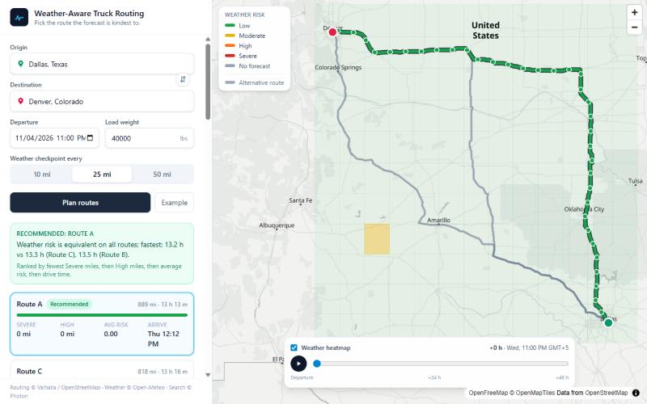

# Weather-Aware Truck Routing

Plan a truck trip, get three route options, and see which one the **forecast at the
time the truck will actually be there** is kindest to.



**Live app:** https://spotter-truck-routing-vh98.onrender.com (Render free tier: the
first request after ~15 min idle takes ~30–60 s to wake up) · **Walkthrough video:** _TBD (Loom)_

## What it does

1. Enter an origin and destination (typeahead), departure date/time, load weight and a
   checkpoint interval (10 / 25 / 50 mi, default 25).
2. The backend asks Valhalla for **3 truck routes** (`costing: truck`, two alternates,
   gross weight from your load).
3. Each route is sampled every N miles. Each checkpoint gets an **ETA**: departure plus
   the drive time to that point, built from Valhalla's per-maneuver times, so slow
   urban stretches are slow.
4. Open-Meteo gives the hourly forecast **for the hour nearest each checkpoint's ETA**.
5. The risk engine grades wind, gusts, rain and snow, applies the load rules, and takes
   the worst factor as the checkpoint's level.
6. Routes are ranked: **fewest Severe miles → fewest High miles → lowest average risk →
   shortest time**. The UI says which tie-breaker decided it.
7. The map shows the routes (the selected one coloured by risk), checkpoints with
   weather popups, a legend, a side panel with the comparison, and a **0–48 h weather
   heatmap** you can scrub or play.

## Risk model

All thresholds live in one file, [`backend/routing/risk_rules.py`](backend/routing/risk_rules.py).
The boundary tests in `tests/test_risk.py` are generated from that same table, so editing
a number keeps the tests honest.

| Level | Sustained wind | Gusts | Rain | Snow |
|---|---|---|---|---|
| Low | < 20 mph | < 35 mph | < 0.10 in/h | < 0.10 in/h |
| Moderate | ≥ 20 mph | ≥ 35 mph | ≥ 0.10 in/h | ≥ 0.10 in/h |
| High | ≥ 35 mph | ≥ 50 mph | ≥ 0.30 in/h | ≥ 0.50 in/h |
| Severe | ≥ 45 mph | ≥ 60 mph | ≥ 0.50 in/h | ≥ 1.00 in/h |

**Load rules** apply only to factors already at Moderate or worse, and raise them by one level:
- **Light load (≤ 10,000 lbs):** wind and gust risk +1. Empty trailers are prone to blow-over.
- **Heavy load (≥ 40,000 lbs):** rain and snow risk +1. Heavier trucks need longer stopping distances.

> ⚠️ These numbers must match the assessment brief's table. If the brief differs,
> change `risk_rules.py`; nothing else needs touching.

**Mile accounting.** Each checkpoint stands for the road halfway to its neighbours, so
the stretches add up exactly to the route length. "Severe miles" is the total length
of Severe stretches. "Average risk" is the mile-weighted mean of Low=0 … Severe=3.
Checkpoints beyond the 16-day forecast range are shown as *No forecast* and left out of
the totals, and the UI shows a warning when that happens.

## Architecture

```mermaid
flowchart LR
  UI[React + MapLibre] -- POST /api/plan --> API[Django REST]
  UI -- typeahead --> Photon[(Photon)]
  API --> V[(Valhalla truck routing)]
  API --> OM[(Open-Meteo hourly forecast)]
  subgraph Pure core, unit-tested
    G[geo] --> C[checkpoints + ETA] --> R[risk] --> K[ranking]
    R --> H[heatmap grid]
  end
  API --- C
```

```
backend/
  project_root/        settings (env-driven), urls
  routing/
    clients/valhalla.py   3 truck routes, polyline6, 1 req/s throttle, cache
    clients/openmeteo.py  batched multi-coordinate hourly forecasts, cache
    geo.py                polyline decode, haversine, interpolation
    checkpoints.py        every N miles + ETA            (pure)
    risk_rules.py         the threshold table             (data)
    risk.py               weather + load -> level/reasons (pure)
    ranking.py            summaries + ordering + reason   (pure)
    heatmap.py            <=150-cell grid x 49 hours      (pure)
    service.py            orchestration for /api/plan
  tests/                  99 tests on real API fixtures, no network
frontend/
  src/api/                typed client (TanStack Query), Photon search
  src/components/         TripForm, PlaceInput, MapView, RoutePanel, MapOverlays
```

### Key decisions

- **Valhalla (public OSM server) for routing.** OpenRouteService's public API caps
  alternative routes at 100 km, which rules it out for long-haul trips. Valhalla's
  `truck` costing returns 3 routes with no API key. Its public server allows 1 request
  per second, so calls are throttled per process and responses are cached.
- **Photon for typeahead.** Nominatim's usage policy forbids autocomplete; Photon is built for it.
- **Open-Meteo for weather.** Free, no key, hourly data up to 16 days ahead, and many
  coordinates per request. We ask for `mph` and `inch` so values compare directly with
  the table, and snowfall then also comes back in inches. Points are rounded to about
  1 km and de-duplicated, so overlapping routes share requests.
- **One endpoint.** `/api/plan` returns everything, including the heatmap. The slider
  works entirely on the client, with no refetching while scrubbing.
- **Stateless backend.** No database. Results are cached in memory (30 min for routes,
  1 h for forecasts).
- **A single deployable.** Django serves the built React app through WhiteNoise, so
  there is one URL, no CORS, and one Docker image.

## API

`POST /api/plan`

```json
{
  "origin": { "lat": 32.7767, "lon": -96.797, "label": "Dallas, Texas" },
  "destination": { "lat": 39.7392, "lon": -104.9903, "label": "Denver, Colorado" },
  "departure": "2026-11-06T08:00:00-06:00",
  "load_weight_lbs": 42000,
  "interval_miles": 25
}
```

The response has `recommended_route_id`, `recommendation_reason`, `routes[]` (geometry,
summary, `checkpoints[]` with ETA/weather/risk/reasons), `heatmap` (grid cells × 49
hourly risk scores) and `warnings[]`. Errors always look like
`{"error": {"code", "message"}}`, with status 400 (validation), 422 (no truck route),
429 (rate limit), 502 or 504 (an upstream service failed or timed out).
`GET /api/health` returns `{"status": "ok"}`.

## Run locally

Requires Python 3.11+ and Node 20+.

```bash
# backend (http://127.0.0.1:8000)
cd backend
python -m venv .venv
.venv/Scripts/activate          # macOS/Linux: source .venv/bin/activate
pip install -r requirements-dev.txt
cp .env.example .env            # set SECRET_KEY to any string for local use
python manage.py runserver
```

```bash
# frontend (http://localhost:5173, proxies /api to :8000)
cd frontend
npm install
npm run dev
```

Tests and checks:

```bash
cd backend && pytest && ruff check . && ruff format --check .
cd frontend && npm run lint && npm run build
```

## Deploy

The repo includes a multi-stage [`Dockerfile`](Dockerfile): it builds the frontend,
then runs Django under gunicorn. [`render.yaml`](render.yaml) is a one-click Render
Blueprint (free plan, health check on `/api/health`, generated `SECRET_KEY`). Any
Docker host works the same way. The variables are listed in
[`backend/.env.example`](backend/.env.example).

## Limitations and next steps

- The risk thresholds are documented defaults until they're checked against the brief (see above).
- The public Valhalla and Photon servers are best-effort. For production, self-host
  Valhalla, or use a commercial truck-routing API that also knows bridge heights and
  hazmat restrictions.
- Forecasts are hourly and about 9–11 km resolution. Short, intense cells between
  checkpoints can be missed; a 10-mile interval reduces this.
- The cache is per process. Redis would let several instances share it.
- Possible next steps: departure-time optimisation (try ±N hours and pick the safest
  window), visibility and ice factors, and route-level notifications when the forecast
  changes.

## Credits

Routing © [Valhalla](https://github.com/valhalla/valhalla) / OpenStreetMap contributors ·
Weather © [Open-Meteo](https://open-meteo.com) · Geocoding © [Photon](https://photon.komoot.io) ·
Basemap © [OpenFreeMap](https://openfreemap.org) / OpenMapTiles.
Initial Django and React scaffolding was generated with architect-mcp.
